<!-- Generated by `python3 -m profilegen` from profile.toml. Edit that file, not this one. -->

<picture>
  <source media="(prefers-color-scheme: dark)" srcset="assets/header-dark.svg">
  <source media="(prefers-color-scheme: light)" srcset="assets/header-light.svg">
  
</picture>

📺 I build the software behind Hotel Care's in-room TV, Wi-Fi and telephony, deployed across ~480 hotels, clinics and campsites. 
📍 Provence, France

<h3 align="center">Projects</h3>

<picture>
  <source media="(prefers-color-scheme: dark)" srcset="assets/projects-dark.svg">
  <source media="(prefers-color-scheme: light)" srcset="assets/projects-light.svg">
  
</picture>

<h3 align="center">Stack</h3>

<picture>
  <source media="(prefers-color-scheme: dark)" srcset="assets/stack-dark.svg">
  <source media="(prefers-color-scheme: light)" srcset="assets/stack-light.svg">
  
</picture> 
Kotlin · Python · Flask · SQLite · Go · JavaScript · Windows Server · GitHub Actions

<h3 align="center">Contributions</h3>

<picture>
  <source media="(prefers-color-scheme: dark)" srcset="assets/stats-dark.svg">
  <source media="(prefers-color-scheme: light)" srcset="assets/stats-light.svg">
  
</picture>

